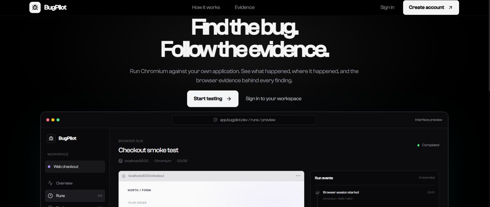
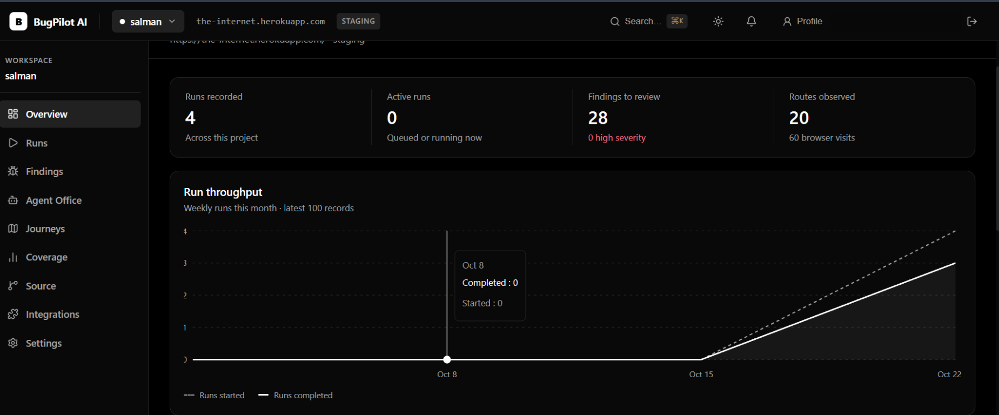
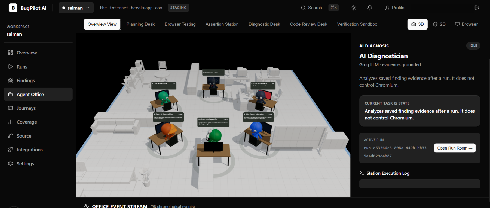

# BugPilot AI

BugPilot is a local-first browser QA workspace. Signed-in users can create
projects for verified websites, start a local Chromium run, and inspect
persisted run events and screenshots.

## Screenshots

### Product landing page



### Project overview



### Agent Office



## Current implementation

- Firebase Authentication supports email/password and Google sign-in.
- Firebase Admin stores account profiles and user-owned project configuration
  under `users/{uid}` and `users/{uid}/projects/{projectId}`.
- Neon Postgres stores local run records, browser events, route visits, findings,
  verifications, and screenshot artifacts. Redis queues local Playwright jobs.
- The browser worker is development-only and runs on the developer's machine.
- External project origins can be authorized by adding a DNS TXT ownership
  record through the project-creation flow. Only verified HTTPS origins on
  standard ports are accepted; local development origins can still use the
  exact `LOCAL_WORKER_ALLOWED_ORIGINS` setting.
- Console errors and failed network responses are deduplicated into persistent,
  reviewable findings. These deterministic signals are not AI diagnoses.
- Users can request an optional bounded Groq diagnosis for a finding. Its
  evidence-linked hypotheses and suggested checks are persisted as unverified
  guidance using `openai/gpt-oss-120b` by default; the model cannot determine
  run pass/fail or produce applied fixes.
- Findings can be checked in a fresh bounded browser run. Verification passes
  only when at least one page loads, the run completes without timing out, and
  the exact recorded signal is not observed; this does not prove a root cause is fixed.
- Saved journeys persist project-scoped crawl presets (name, same-origin start
  path, and objective) in Neon. Starting a preset opens the existing run form
  with its path and objective prefilled; objectives are context only, because
  the worker currently crawls same-origin links rather than executing scripted
  clicks or form actions. Source changes and integration connections are not
  currently persisted. Route coverage is derived from routes actually visited
  by local runs.

## Run locally

```powershell
npm install
npm run dev
```

Configure Firebase, Neon, Redis, and the local worker first. Follow the
[local Playwright worker setup](./docs/hosting/local-playwright-worker.md) for
the complete instructions, allowlist requirements, and safety limits.

## Workspace routes

| Route | Purpose |
|---|---|
| `/` | Product overview and current worker scope |
| `/sign-in`, `/sign-up` | Firebase email/password and Google authentication |
| `/app` | List or create projects owned by the signed-in account |
| `/app/[projectId]` | Project overview with recorded local runs |
| `/app/[projectId]/runs` | Run history for the selected project |
| `/app/[projectId]/runs/new` | Configure a local Chromium run |
| `/app/[projectId]/runs/[runId]` | Inspect a persisted run and its live event stream |
| `/app/[projectId]/findings` | Review findings and their fresh verification history |
| `/app/[projectId]/journeys` | Save and reuse same-origin crawl presets |
| `/app/[projectId]/coverage` | Review routes visited by local runs |
| `/app/[projectId]/settings` | Edit the project's saved name, URL, and environment |

Other workspace navigation items remain available as setup/empty states until
their data is persisted by the product.

## Validate

```powershell
npm run test:local
npm run lint
npm run build
```
